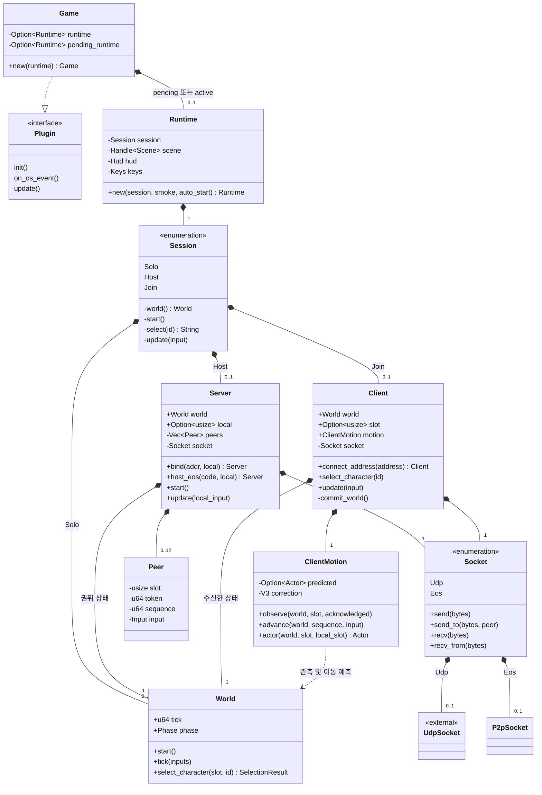
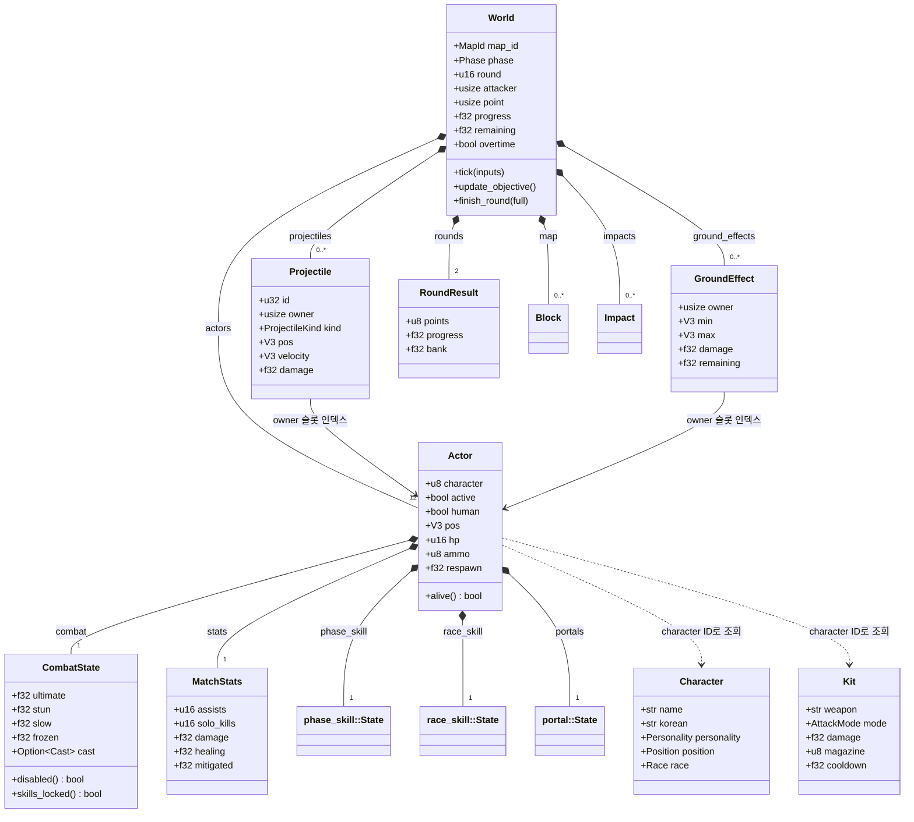
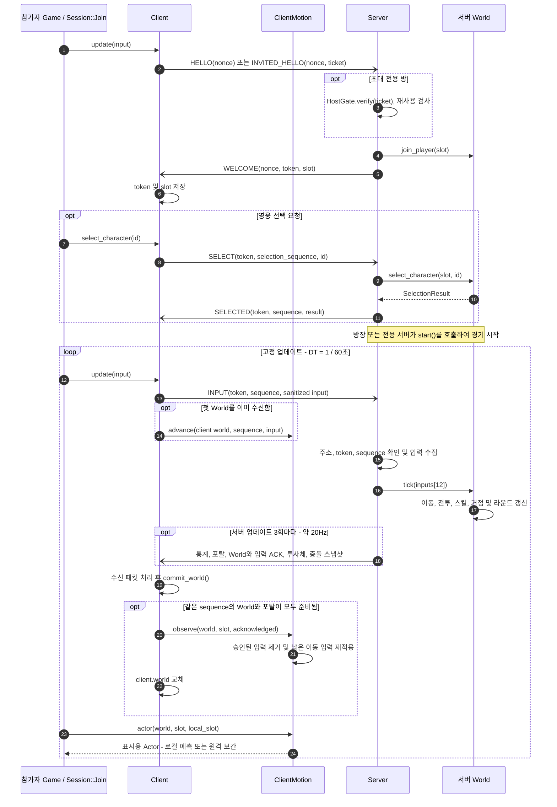
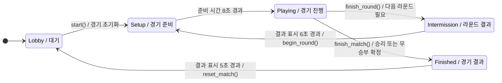

# Fyrox-TSB UML

현재 Rust 소스를 기준으로 정리한 핵심 UML입니다. 작성 기준일: 2026-11-21.
Mermaid를 지원하는 Markdown 미리보기에서 각 다이어그램을 볼 수 있습니다.

Rust의 `struct`는 클래스, `enum`은 열거형, `trait` 구현은 인터페이스 실체화로 표현했습니다.
가독성을 위해 주요 필드와 메서드만 표시했습니다. `*--`는 값/박스의 소유,
`..>`는 사용 의존성, `..|>`는 trait 구현입니다. `+`는 공개, `-`는 비공개입니다.

## 1. 실행 및 네트워크 클래스

- `Session`은 `Solo(Box<World>)`, `Host(Box<Server>)`, `Join(Box<Client>)` 중 하나만 보유합니다. `Socket`의 UDP/EOS도 서로 배타적이며, EOS는 `eos` feature에서만 포함됩니다.
- `Game`은 초기화 전에 `pending_runtime`, 초기화 후에 `runtime`으로 실행 상태를 보유합니다. `Plugin`은 `fyrox::plugin::Plugin`, `UdpSocket`은 표준 라이브러리 타입입니다.
- 다이어그램의 `World`는 타입을 뜻합니다. 서버와 클라이언트가 같은 인스턴스를 공유하지 않습니다. 실제 경기 판정은 서버/솔로의 `World::tick()`에서 수행하고, 참가자의 `World`는 수신한 상태로 갱신합니다.
- `ClientMotion`은 로컬 이동 예측과 원격 플레이어 보간을 담당합니다. 체력과 피해 판정은 서버 상태를 따릅니다.
- 그래픽 실행 진입점은 [`src/main.rs`](../src/main.rs)입니다. [`src/bin/server.rs`](../src/bin/server.rs)는 `Game`과 `Runtime` 없이 `Server`를 직접 구동하는 전용 서버입니다. 로컬 호스트는 자신이 한 슬롯을 차지하므로 원격 참가자는 최대 11명, 전용 서버는 최대 12명입니다.

근거: [`presentation.rs`](../src/presentation.rs)의 `Game`, `Runtime`, `Session`, [`net.rs`](../src/net.rs)의 `Server`, `Client`, `Peer`, [`prediction.rs`](../src/prediction.rs), [`transport.rs`](../src/transport.rs), [`eos.rs`](../src/eos.rs).

## 2. 경기 데이터 클래스

- `actors`는 항상 **12개 슬롯**인 배열입니다. 실제 참가 여부는 `active`, 사람/봇 구분은 `human`으로 나타냅니다. 별도의 `Player`·`Bot` 상속 클래스는 없습니다. 팀은 슬롯 인덱스로 계산합니다.
- `Actor.character`는 캐릭터 객체가 아닌 `u8` ID입니다. `roster::character(id)`와 `kits::kit(id)`가 각각 정적 `ROSTER[15]`, `KITS[15]`의 정의를 반환합니다. 위 `str` 표기는 실제 `&'static str`을 간략히 표현한 것입니다.
- `Projectile.owner`와 `GroundEffect.owner`도 `Actor` 참조가 아닌 슬롯 인덱스입니다. 이 두 연결은 논리적 연관 관계이며 소유 관계가 아닙니다.
- `CombatState`에는 캐릭터별 `State`가 값으로 들어 있습니다. 예를 들어 `vivi_skill::State`, `naia_skill::State`, `chloe_skill::State` 등이 있으며, 공통 `Skill` 상속 계층은 없습니다. 캐릭터별 세부 필드는 이 그림에서 생략했습니다.
- 전투·스킬·통계·라운드 처리의 일부 메서드는 각 모듈의 `impl World`에 나뉘어 구현되어 있습니다. 소스 파일이 나뉘어 있어도 동일한 `World` 타입의 메서드입니다.

근거: [`game.rs`](../src/game.rs), [`combat.rs`](../src/combat.rs), [`ground_effect.rs`](../src/ground_effect.rs), [`match_stats.rs`](../src/match_stats.rs), [`roster.rs`](../src/roster.rs), [`kits.rs`](../src/kits.rs), [`phase_skill.rs`](../src/phase_skill.rs), [`race_skill.rs`](../src/race_skill.rs), [`portal.rs`](../src/portal.rs).

## 3. 접속 및 상태 동기화 시퀀스

UDP와 EOS에 공통으로 적용되는 정상 접속 및 게임 업데이트 경로입니다. 전송 계층은 화살표로 축약했으며,
네트워크 메시지는 비동기입니다. 두 프로세스의 업데이트가 같은 시각에 실행된다는 의미는 아닙니다.
초대 인증 실패, 방 정원 초과, 연결 종료, 채팅·음성 메시지는 생략했습니다.

`Client::update()`는 입력을 전송하고 이동 예측을 진행한 뒤 수신 큐를 처리합니다.
`Server::update()`는 입력을 모아 `World::tick()`을 한 번 실행하고, 매 3회 업데이트마다 스냅샷을 전송합니다.
`Client::commit_world()`는 같은 sequence의 **World + 포탈 상태**가 모인 최신 항목만 반영합니다.
통계·투사체·충돌 스냅샷은 별도 sequence로 처리하므로, 모든 스냅샷을 하나의 원자적 묶음으로 기다리지는 않습니다.

근거: [`net.rs`](../src/net.rs)의 `Server::update`, `Client::update`, `Client::commit_world`, [`prediction.rs`](../src/prediction.rs)의 `advance`, `observe`, `actor`.

## 4. 경기 상태 전이

아래 다섯 상태는 [`game::Phase`](../src/game.rs)의 실제 enum 값입니다.
홈·로그인·영웅 선택·메뉴 화면은 표현 계층의 UI 상태이므로 이 경기 상태 머신과 별개입니다.

- **거점 A 점령**은 `Playing`을 유지하면서 거점 B를 열고, 정규 라운드에서는 180초를 추가합니다. **거점 B 점령** 또는 **시간 종료 시 거점에 공격자 없음**은 `finish_round()`로 이어집니다.
- `finish_round()`는 공수 교대·추가 라운드가 필요하면 `Intermission`, 최종 결과가 정해지면 `Finished`로 이동합니다. 따라서 라운드 종료가 항상 `Intermission`을 거치는 것은 아닙니다.
- **추가시간**은 별도 `Phase`가 아니라 `World.overtime` 플래그입니다. 시간이 0이어도 거점에 공격자가 남아 있으면 계속 진행하며, 공격자가 사라지거나 목표를 달성하면 종료 조건을 평가합니다.
- **추가 라운드**도 별도 `Phase`가 아닙니다. `extra`, `banks`, `order`, `leg`, `free_attack` 값에 따라 같은 `Setup → Playing` 흐름을 반복합니다.
- 어느 한 팀이 비어 있으면 `Playing`에서 경기 시간과 거점 진행이 멈춥니다. 이동과 연습은 계속 가능합니다.
- 경기 종료 후 `reset_match()`는 맵·참가 슬롯·캐릭터 선택을 유지하면서 경기 상태를 초기화합니다. 방을 새로 만드는 전이가 아닙니다.

근거: [`game.rs`](../src/game.rs)의 `start`, `begin_round`, `tick`, `update_objective`, `finish_round`, `finish_match`, `reset_match`, [`round_transition.rs`](../src/round_transition.rs)의 `ROUND_RESULT_SECONDS`.

## 범위

이 문서는 실행 구조, 경기 데이터, 동기화, 경기 상태에 집중한 소스 기반 요약입니다.
계정·친구·방 목록 HTTP API, 채팅·음성, 데스캠, 렌더링 세부 타입 및 캐릭터별 스킬 전체는 생략했습니다.
소스 변경에 자동 연동되는 문서는 아니므로 타입·프로토콜·상태 전이가 바뀌면 함께 갱신해야 합니다.
