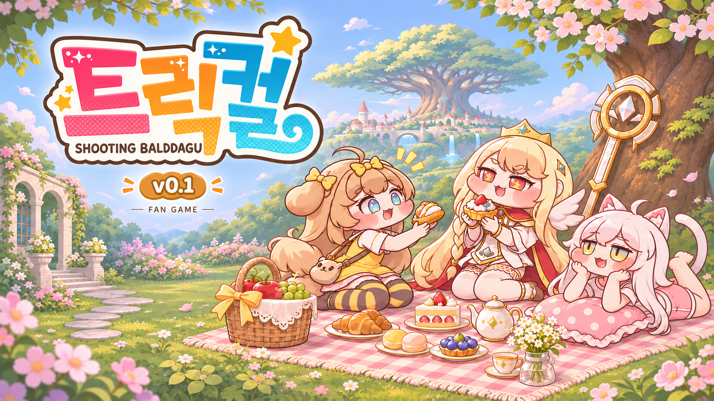

# Trickcal : Shooting Balddagu v0.1

트릭컬의 사도들과 함께하는 6 대 6 거점 점령 FPS 팬게임의 첫 공개 개발 버전입니다. 2026년 11월 21일까지 구현한 전투·캐릭터·맵·로비·계정 연동을 v0.1로 묶었습니다.



## 버전 정보

- 개발 시작일: **2026년 11월 12일**
- 게시일: **2026년 11월 21일**
- 버전: **v0.1** (Rust 패키지 버전 `0.1.0`)
- 제작 환경: Rust · Fyrox 1.0.1
- 배포 대상: Windows 10/11 64비트
- 개발 단계: 공개 테스트용 프로토타입 / GitHub Pre-release

### 2026-11-21 핫픽스

버전 표기는 **v0.1**로 유지하고 `TSB.exe`를 교체했습니다. 마요의 1인칭 E·Q에서 왼팔 소매가 팔꿈치 부근에서 찌그러지던 문제를 수정했습니다. 손바닥과 총의 접점을 유지하면서 위팔·아래팔의 비틀림을 맞췄습니다. 기존 파일을 받았다면 아래 다운로드에서 다시 받아 실행하세요.

## 주요 구현

- 15명 사도의 기본 공격·일반 스킬(E)·궁극기(Q)와 종족별 공용 스킬(Shift).
- 요정왕국 성·엘프 도시 두 전장, 최대 6 대 6의 A → B 거점 점령과 공수 교대·추가시간.
- 방 생성·코드 참가, 선택형 봇 추가, 혼자 시작할 수 있는 연습 모드.
- 캐릭터 선택과 볼 당기기, 춤, 1인칭 무기와 손, 캐릭터별 모션·표정.
- 체력·탄약·스킬·궁극기 HUD, 점수판, 관전·데스캠, 그래픽·음량 설정.
- 텍스트·음성 채팅, 캐릭터 음성·배경음악·효과음, DotG 로그인·프로필·친구 기능 연동.

## 다운로드와 실행

1. [Windows v0.1 다운로드](https://github.com/pinata0/Fyrox-TSB/releases/download/v0.1/TSB.exe?build=9dcd2536f2a3)에서 **`TSB.exe` 하나**를 다운로드합니다.
2. Windows에서 더블클릭해 실행합니다. 별도 설치나 관리자 권한은 필요하지 않습니다.
3. 로그인하거나 게스트로 시작한 뒤 플레이에서 방을 만들거나 참가합니다. 혼자 연습하거나 봇을 추가할 수도 있습니다.

첫 실행은 게임 리소스를 `%LOCALAPPDATA%\TSB\SingleFile\빌드해시`에 자동으로 풀기 때문에 시간이 걸릴 수 있습니다. 이후에는 추출된 캐시를 재사용합니다. 게임·런타임 DLL·에셋·게임 클라이언트용 EOS 설정이 포함되어 있으며 개인 로그인 세션은 포함하지 않습니다. OpenGL을 지원하는 그래픽 드라이버가 필요합니다.

멀티플레이는 **동일한 v0.1 실행파일**을 사용하세요. 호스트가 방을 만들고 코드를 전달하면 참가자는 방 참여하기에서 코드를 입력합니다. 방장이 게임 시작을 누르면 캐릭터 선택 후 경기에 입장합니다.

기본 조작: WASD 이동 · 마우스 시점 · 좌클릭 기본 공격 · E 일반 스킬 · Q 궁극기 · Shift 종족 스킬 · H 캐릭터 선택 · Enter 채팅 · M 마이크 · Esc 메뉴.

## 검증과 알려진 제한

2026년 11월 21일 마요 팔 핫픽스를 릴리스 최적화 빌드와 단일 EXE로 다시 패키징했습니다.

- `TSB.exe`: **339,195,143바이트 (약 323.5 MiB)**, 내부 파일 1,766개.
- 새 작업 폴더에서 최초 추출·파일별 무결성 검사(`--verify-only`) 및 EOS DLL 오프라인 초기화 통과.
- 핫픽스 패키지에서 마요 E/Q·복귀 19개, 기본 무기 5개, 인사 6개 GPU 화면 검사와 정상 종료 통과. 실행 후 패키지 무결성 재검사도 통과했습니다.
- 초기 공개본의 헤드리스 자동 테스트: **495개 통과 / 3개 실패**. `ghost_phase`의 벽 안 캐릭터 교체 오류 사유 1건과 `roster`의 충격파 밀쳐내기 판정 2건이 기대값과 다릅니다. 핫픽스에서 전체 헤드리스 검사는 다시 실행하지 않았습니다.
- 초기 공개본 패키지의 종합 GPU 스모크 테스트는 메뉴·전투 화면을 생성했지만 최종 완료 조건에서 실패했습니다. 전체 회귀 테스트 통과로 간주하지 않습니다.
- 핫픽스 개발 중 전체 캐릭터 인사 검사는 클로에 소매 방향 검사에서 중단됐습니다. 마요 단독 인사와 109틱 연속성 검사는 통과했습니다.

SHA-256 (`TSB.exe`):

```text
9dcd2536f2a37f4349331a446c47a87985cf15d2d2cc7c9150e5e0847ffc5cc7
```

PowerShell에서 `Get-FileHash .\TSB.exe -Algorithm SHA256`으로 확인할 수 있습니다. `TSB.exe.sha256`은 선택적으로 받을 수 있는 검증용 텍스트이며 실행에 필요하지 않습니다.

- 다른 PC 사이의 실제 EOS 중계·인터넷 대전 및 높은 지연·손실 환경은 별도 검증이 필요합니다.
- 호스트가 종료하면 경기가 끝납니다. 호스트 이전, 상용 안티치트, 서버 사격의 과거 시점 보상은 구현하지 않았습니다.
- v0.1은 완성판이 아니며 밸런스·모션·충돌·UI가 개발 중입니다. 홈 화면 일부 부가 메뉴는 표시 전용입니다.
- 이번 릴리즈의 실행 자산은 Windows 단일 EXE입니다. 저장소의 Linux 제작 문서는 별도 개발 기록입니다.

문제를 제보할 때는 캐릭터·맵·재현 순서와 `%LOCALAPPDATA%\TSB\SingleFile\빌드해시\artifacts\logs`의 관련 로그를 첨부해 주세요. 로그에 개인 정보가 있다면 지운 뒤 공유해 주세요.

## 프로젝트

- [소스 저장소](https://github.com/pinata0/Fyrox-TSB)
- [DotG 프로젝트 소개](https://www.dotgsince2023.co.kr/projects/trickcal-shooting-balddagu)

원작 트릭컬의 캐릭터·로고·음성·음악 등 관련 권리는 EPID Games 및 각 권리자에게 있습니다. 본 프로젝트는 비공식 팬게임이며 공식 서비스와 무관합니다. 대표 이미지는 기존 게임 아트를 참고한 AI 생성 홍보 일러스트로 실제 플레이 화면이 아닙니다.
